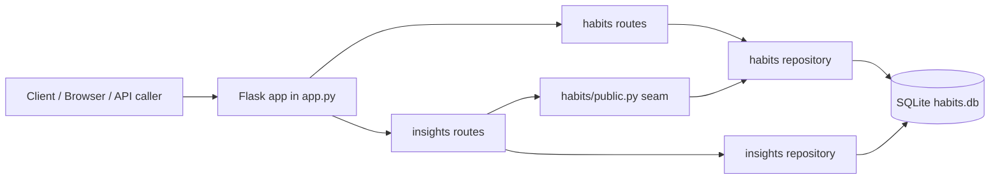

# Habit Tracker Project Report

## 1. Project overview

This project delivers a small Flask + SQLite habit tracker that follows the assignment constraints for a single-process, single-container application. The software is organized into two logical domains:

- `habits/`: habit records, check-ins, daily/weekly streak logic, and template data
- `insights/`: completion-rate calculations, milestone detection, and summary endpoints

The key design constraint is the seam in `habits/public.py`: the insights domain may only use this narrow public API and must not directly query `habits.repository` or the `habits` / `checkins` tables.

The project is intentionally small, explainable, and easy to reason about. It avoids background workers, external services, and infrastructure beyond the SQLite database and local Flask process.

## 2. SDLC and development approach

This project used an iterative, incremental SDLC model with a time-compressed delivery window. The work was split into a small number of coherent milestones:

1. Create the app factory, environment configuration, schema bootstrapping, and seed loading.
2. Implement the habits domain and core streak logic.
3. Add the insights domain, seam, and milestone summary logic.
4. Validate the API, apply fixes, and document the project decisions.
5. Verify the code and finalize the documentation package.

The timeline was compressed relative to the ideal assignment plan, but the process remained honest and incremental. Each milestone was validated with the existing test suite before moving forward.

## 3. Architecture

The application runs as a single Flask process and serves a responsive HTML dashboard together with JSON routes for habits and insights. All surfaces use the same SQLite database under the configured `DATA_DIR`, which keeps the project within the single-container requirement.



The seam is the most important architectural boundary in the system. `insights` is allowed to call `habits.public` only, which means it can ask for allowed facts such as check-in dates and current streak without reaching into the habits database implementation directly.

## 4. Database model

The schema intentionally keeps the two domains separated while sharing one SQLite file. The habits domain owns the habit records and check-ins, while the insights domain owns milestone records. The `milestones.habit_id` field intentionally has no foreign key to enforce the service boundary and allow future extraction in Assignment 2.

```mermaid
erDiagram
    HABITS ||--o{ CHECKINS : has

    HABITS {
        INTEGER id PK
        TEXT name
        TEXT cadence
        TEXT created_at
    }

    CHECKINS {
        INTEGER id PK
        INTEGER habit_id FK
        TEXT checked_on
        UNIQUE(habit_id, checked_on)
    }

    HABIT_TEMPLATES {
        INTEGER id PK
        TEXT name
        TEXT cadence
    }

    MILESTONES {
        INTEGER id PK
        INTEGER habit_id
        TEXT kind
        TEXT achieved_on
        UNIQUE(habit_id, kind)
    }
```

`HABIT_TEMPLATES` is a standalone reference-data table. `MILESTONES.habit_id` is a logical reference only and has no foreign key. The `UNIQUE(habit_id, checked_on)` constraint makes repeated check-ins on the same day idempotent.

## 5. Business logic highlights

The habits logic is intentionally pure and unit-testable:

- `current_daily_streak()` counts consecutive days ending on today or yesterday.
- `current_weekly_streak()` counts consecutive ISO weeks with a check-in.
- `completion_rate()` computes the fraction of completed days in a window.

The insights logic then builds on those values:

- `best_weekday()` identifies the weekday with the largest number of check-ins.
- `milestone_kinds()` derives milestone names such as `streak_7`, `streak_30`, etc.
- `insights.routes` exposes summary endpoints without importing the habits repository directly.

## 6. Testing and validation

The project uses `pytest` and `pytest-cov` to validate the core business logic and key route behavior. The suite checks:

- app creation and environment configuration
- database bootstrapping and idempotent seeding
- streak logic for daily and weekly behaviors
- completion-rate calculations
- habit creation, check-in idempotency, and errors for missing records
- template creation and insight summary endpoints

The current local validation command is:

```bash
ruff check .
ruff format --check .
mypy
pytest --cov=. --cov-report=term-missing
```

Latest recorded validation: 30 tests passed and 98% coverage. Ruff lint/format/security checks and mypy are configured as local pre-commit gates. Docker validation requires Docker to be installed on the machine running the checker; it was unavailable in the development environment.

## 7. AI disclosure and evidence

This project includes an AI usage log at [AI_USAGE.md](./AI_USAGE.md). The log is intentionally kept as a template until the student fills it in after final review, as required by the assignment instructions. The report here documents the system architecture and the decisions made without claiming the student’s own words for AI-generated content.

## 8. Conclusion

The project successfully demonstrates a minimal but honest implementation of a Flask + SQLite habit tracker with a clean domain split, a narrow seam, idempotent data loading, and a testable business-logic layer. It remains aligned with the assignment constraints and is ready for final human review and final git-based handoff.
