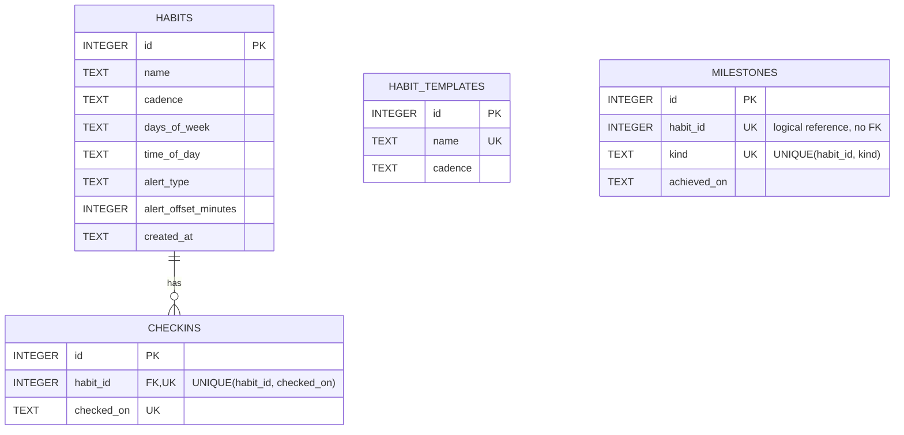

# HabitTracker Project Report

## 1. Project overview

This project delivers HabitTracker, a small Flask + SQLite habit tracker that follows the assignment constraints for a single-process, single-container application. Its responsive browser dashboard supports per-weekday schedules, times, and configurable browser/in-page reminders while open. The software is organized into two logical domains:

- `habits/`: habit records, check-ins, daily/weekly streak logic, and template data
- `insights/`: completion-rate calculations, milestone detection, and summary endpoints

The key design constraint is the seam in `habits/public.py`: the insights domain may only use this narrow public API and must not directly query `habits.repository` or the `habits` / `checkins` tables.

The project is intentionally small, explainable, and easy to reason about. It avoids background workers, external services, and infrastructure beyond the SQLite database and local Flask process.

## 2. SDLC and development approach

This project used an iterative, incremental SDLC model with a time-compressed delivery window. The work was split into a small number of coherent milestones:

1. Create the app factory, environment configuration, schema bootstrapping, and seed loading.
2. Implement the habits domain and core streak logic.
3. Add the insights domain, seam, and milestone summary logic.
4. Validate the API, apply fixes, and document the project decisions.
5. Verify the code and finalize the documentation package.

The timeline was compressed relative to the ideal assignment plan, but the process remained honest and incremental. Each milestone was validated with the existing test suite before moving forward.

### SMART goals

| Goal | Specific / measurable target | Deadline | Result |
|---|---|---|---|
| Two working domains | Habits and insights each read and write SQLite through their own repository module | 2026-10-11 | Met (commit `7903474`) |
| Clean seam | `insights/` imports nothing from `habits/` except `habits.public` | 2026-10-11 | Met |
| Test coverage | ≥70% line coverage with `pytest --cov` | 2026-10-12 | Met: 93% |
| Container contract | `run.sh` passes against the filled template | 2026-10-12 | Not yet run: Docker unavailable on the development machine |
| Commit cadence | ≥12 meaningful commits over ≥6 days, ≤40% per day | 2026-10-12 | Not met: work started 2026-10-09, so at most 4 calendar days were available |

### How the model was followed in practice

Iterations 1-3 matched the plan. The browser dashboard and scheduled reminders were added on the last day after the core domains were finished, which compressed testing and documentation into the final iteration. The late start is the main deviation from the plan and the reason the commit-cadence goal was missed.

## 3. Architecture

The application runs as a single Flask process and serves a responsive HTML dashboard together with JSON routes for habits and insights. The dashboard polls for due reminders while open; it does not use a background worker and cannot deliver reminders when the dashboard is closed. All surfaces use the same SQLite database under the configured `DATA_DIR`, which keeps the project within the single-container requirement.

```mermaid
flowchart LR
    A[Browser / API caller] --> B[Flask app in app.py]
    subgraph HabitsDomain[Habits domain]
        U[ui/routes.py Today + Calendar pages]
        C[habits/routes.py]
        S[habits/schedule.py + agenda.py pure logic]
        E[habits/repository.py]
        F[habits/public.py]
    end
    subgraph InsightsDomain[Insights domain]
        D[insights/routes.py]
        T[insights/stats.py pure logic]
        H[insights/repository.py]
    end
    B --> U
    B --> C
    B --> D
    U --> E
    U --> S
    C --> E
    C --> S
    F --> E
    D -- "SEAM: habit_id in, ISO dates / streak / weekdays out" --> F
    D --> T
    D --> H
    E --> G1[(habits, checkins, habit_templates)]
    H --> G2[(milestones)]
    G1 -.same habits.db file.- G2
```

The seam is the arrow from `insights/routes.py` to `habits/public.py`. `insights` may only call `habit_exists`, `checkin_dates`, `current_streak`, and `scheduled_weekdays`; what crosses is a `habit_id` going in and plain values (ISO date strings, an integer streak, weekday numbers) coming out. In Assignment 2 each of these functions becomes an HTTP endpoint on the habits service, and the `milestones` table moves to the insights service's own database. The dashboard in `ui/` belongs to the habits side because it reads and writes habits and check-ins directly.

## 4. Database model

The schema intentionally keeps the two domains separated while sharing one SQLite file. The habits domain owns the habit records and check-ins, while the insights domain owns milestone records. The `milestones.habit_id` field intentionally has no foreign key to enforce the service boundary and allow future extraction in Assignment 2.



`HABIT_TEMPLATES` is a standalone reference-data table. `MILESTONES.habit_id` is a logical reference only and has no foreign key. The `UNIQUE(habit_id, checked_on)` constraint makes repeated check-ins on the same day idempotent.

## 5. Business logic highlights

The habits logic is intentionally pure and unit-testable:

- `parse_schedule()` validates weekday, time, and alert inputs and normalizes custom offsets.
- `current_scheduled_streak()` counts consecutive scheduled dates, ignoring unscheduled days.
- `month_weeks()` and `hourly_slots()` in `habits/agenda.py` lay out the Calendar month grid and Today's hour-by-hour timeline from each habit's `days_of_week` and `time_of_day`.
- `due_reminders()` matches current local minutes to each incomplete habit's alert time, including alerts that cross midnight.
- `completion_rate()` computes the fraction of completed days in a window.
- `scheduled_day_count()` counts how many days in the window the habit was actually due, so a Monday-only habit is measured out of 1 day, not 7.

The insights logic then builds on those values:

- `best_weekday()` identifies the weekday with the largest number of check-ins.
- `milestone_kinds()` derives milestone names such as `streak_7`, `streak_30`, etc.
- `insights.routes` exposes summary endpoints without importing the habits repository directly.

## 6. Testing and validation

The project uses `pytest` and `pytest-cov` to validate the core business logic and key route behavior. The suite checks:

- app creation and environment configuration
- database bootstrapping, idempotent seeding, and additive migration of an existing schema
- streak logic for daily and weekly behaviors
- schedule validation, persistence, scheduled-day toggles, and reminder timing
- completion-rate calculations
- habit creation, check-in idempotency, and errors for missing records
- template creation and insight summary endpoints
- calendar month grid, hourly timeline slots, habit colors, and habit deletion

The current local validation command is:

```bash
ruff check .
ruff format --check .
mypy
pytest --cov=. --cov-report=term-missing
```

Latest validation (2026-10-12): 53 tests passed with 95% total coverage; Ruff lint, formatting, mypy, Python compilation, and `git diff --check` passed. Ruff lint/format/security checks and mypy are configured as local pre-commit gates. Docker validation requires Docker to be installed on the machine running the checker; it was unavailable in the development environment.

### What the tests cover thinly, and why

| File | Coverage | Not covered |
|---|---|---|
| `habits/schedule.py` | 82% | Some rejection branches of `parse_schedule` (non-string time, out-of-range custom amounts) |
| `ui/routes.py` | 84% | Part of `/ui/reminders` parsing and some alert labels in `dashboard()` |
| `app.py` | 95% | The `if __name__ == "__main__"` start line, which is exercised by running the app, not by pytest |

The pure modules (`habits/agenda.py`, `insights/stats.py`, `habits/streaks.py`, `db.py`) are at 96-100% because they carry the business rules. Route files are tested mainly for status codes and error paths, as ADR-4 describes. Browser-side JavaScript (reminder polling, delete confirmation, timeline scrolling) has no automated tests and was checked by hand in the browser.

## 7. Container contract (§7)

| Requirement | How the app meets it |
|---|---|
| One start command | `python app.py`, which is also the Dockerfile `CMD` |
| Bind `0.0.0.0` | `create_app().run(host="0.0.0.0", ...)` in `app.py` |
| Port from env | `int(os.environ.get("PORT", "8000"))` |
| No interactive setup | `init_db` runs on startup inside `create_app`; nothing prompts for input |
| Configurable SQLite path | `$DATA_DIR/habits.db`, default `data/habits.db`; `init_db` creates the folder |
| No external runtime dependency | Only Flask and the standard-library `sqlite3` module |
| One manifest | `requirements.txt` at the root; ruff and mypy settings live in `ruff.toml` and `mypy.ini`, because the checker treats any `pyproject.toml` as a second manifest |
| Env-only configuration | `PORT`, `DATA_DIR`, optional `FLASK_SECRET_KEY`; no `.env` file is read |
| Ready within seconds | Startup is schema creation plus one small seed insert |
| Seed data as code | `seed.json`, inserted by `_seed_habit_templates` only when `habit_templates` is empty |
| No destructive boot | `schema.sql` uses only `CREATE TABLE IF NOT EXISTS`; `_ensure_schedule_columns` only adds missing columns |

A manual check on 2026-10-12 started the app twice on the same empty `DATA_DIR` with `PORT=8123`. It bound all interfaces and kept 5 templates and 1 habit after the restart. The course `run.sh` output is in the README.

## 8. Assignment 2 split plan

The cut runs along the `habits/public.py` seam:

| Today (in-process call) | Assignment 2 (HTTP on the habits service) |
|---|---|
| `habit_exists(db, habit_id)` | `GET /habits/<id>` returning 200 or 404 |
| `checkin_dates(db, habit_id, start, end)` | `GET /habits/<id>/checkins?start=&end=` |
| `current_streak(db, habit_id, today)` | `GET /habits/<id>/streak` (already exists) |
| `scheduled_weekdays(db, habit_id)` | Part of `GET /habits/<id>` |

The habits service keeps `habits`, `checkins`, `habit_templates`, the dashboard, and the calendar. The insights service takes `insights/` and the `milestones` table into its own SQLite file. Because `milestones.habit_id` has no foreign key, that table can move without schema changes. The main new cost is network failure handling: insights must decide what to return when the habits service is down.

## 9. Known limitations

- Dates use the server's local date and reminders use the browser clock; there are no accounts or per-user time zones.
- Reminders appear only while a dashboard tab is open (ADR-5).
- Milestones are recorded when `/insights/<id>/summary` is requested, so a GET request writes data.
- Deleting a habit leaves its `milestones` rows behind, because habits may not write to insights tables. They are never shown again.
- `habits/streaks.py` (daily and weekly streaks) predates the per-weekday schedule and is now used only by its tests; `current_scheduled_streak` replaced it.
- The Flask development server is used, which is acceptable for local Assignment 1 use but not for production traffic.

## 10. AI disclosure and evidence

The detailed, per-interaction log is in [AI_USAGE.md](./AI_USAGE.md).

> I acknowledge the use of [AI SYSTEMS, e.g. Claude and Cursor] to [HOW YOU USED THEM, e.g. generate the initial Flask skeleton, implement scheduled streaks and reminders, and review the project against the assignment rules]. The prompts used include [2-3 REAL PROMPTS]. The output of these prompts was used to [WHAT YOU KEPT, CHANGED, OR REJECTED].

## 11. Conclusion

HabitTracker is a single-process Flask and SQLite app with two domains split at a narrow seam, idempotent startup and seeding, and 95% test coverage. Users can schedule habits on chosen weekdays, see them on a monthly calendar and an hourly timeline, check them off, and delete them. The insights domain reports schedule-aware completion rates, best weekdays, and streak milestones without touching habits storage. The commit-cadence requirement was not met because of the late start, and the container checker still has to be run on a machine with Docker.
